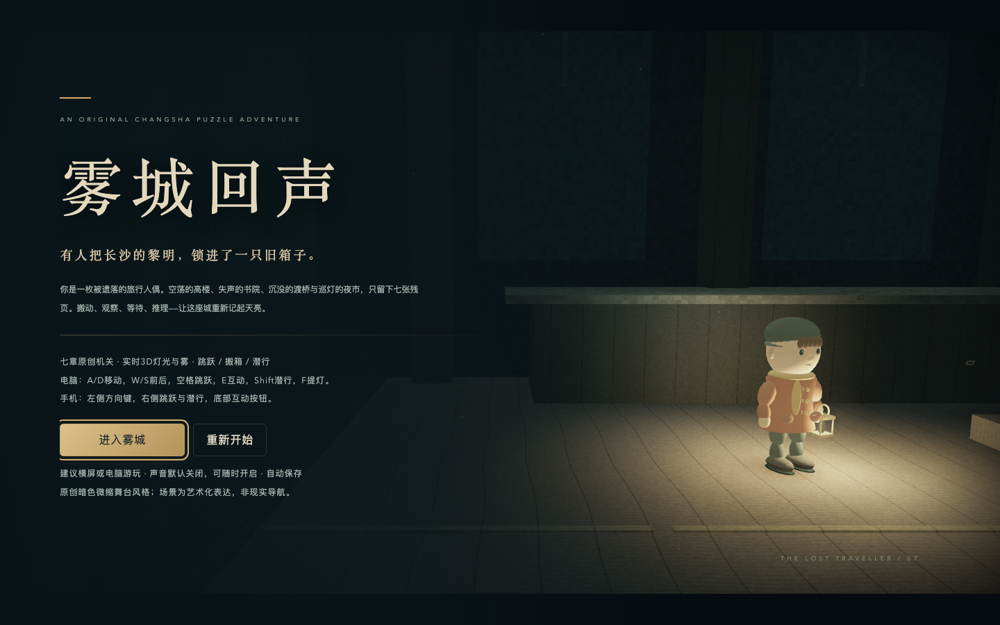
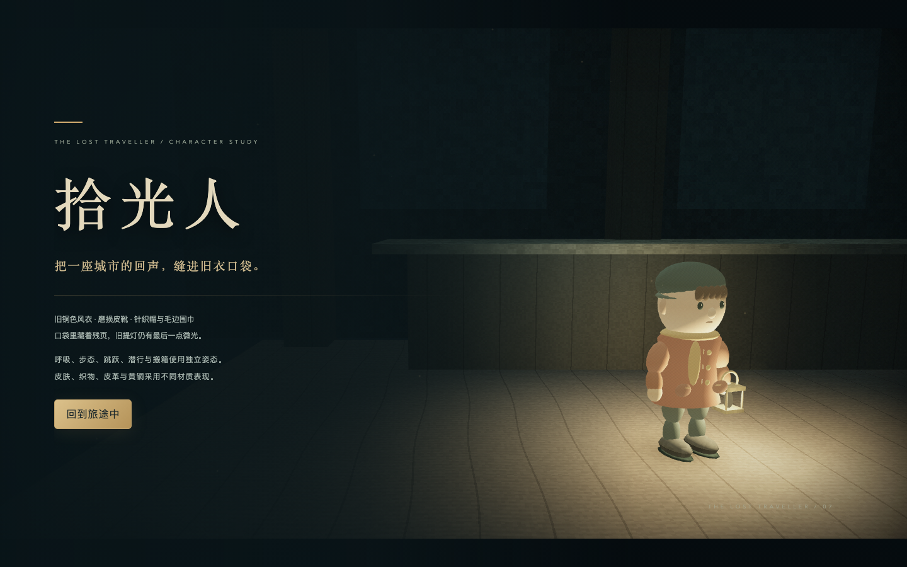
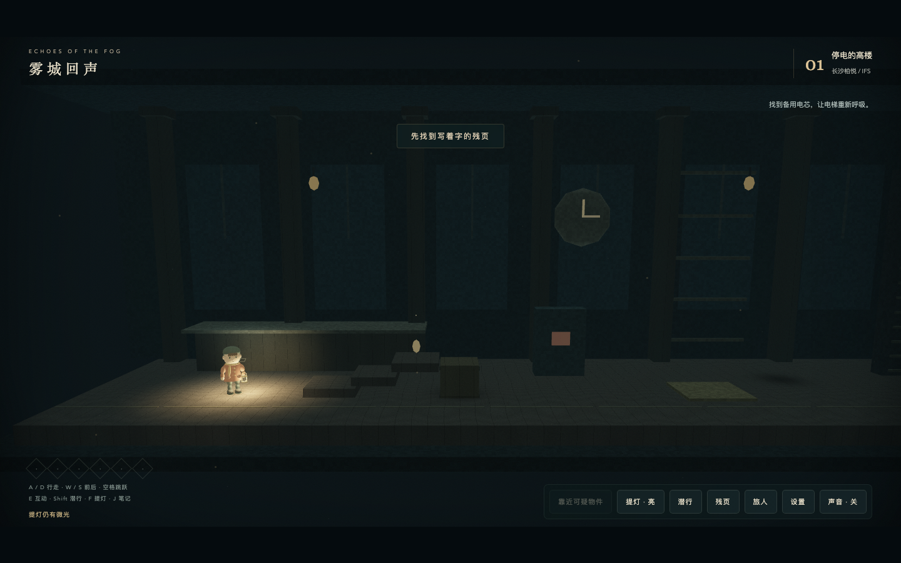
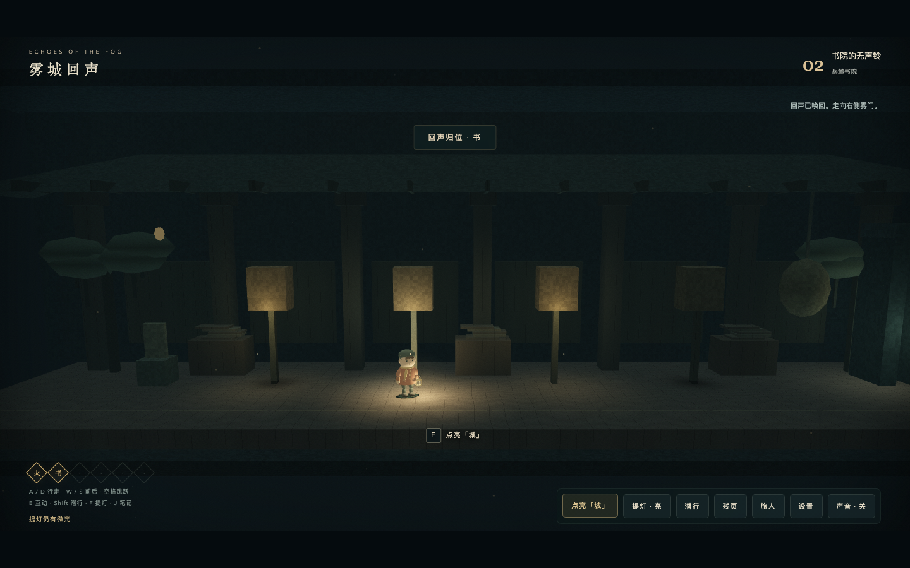
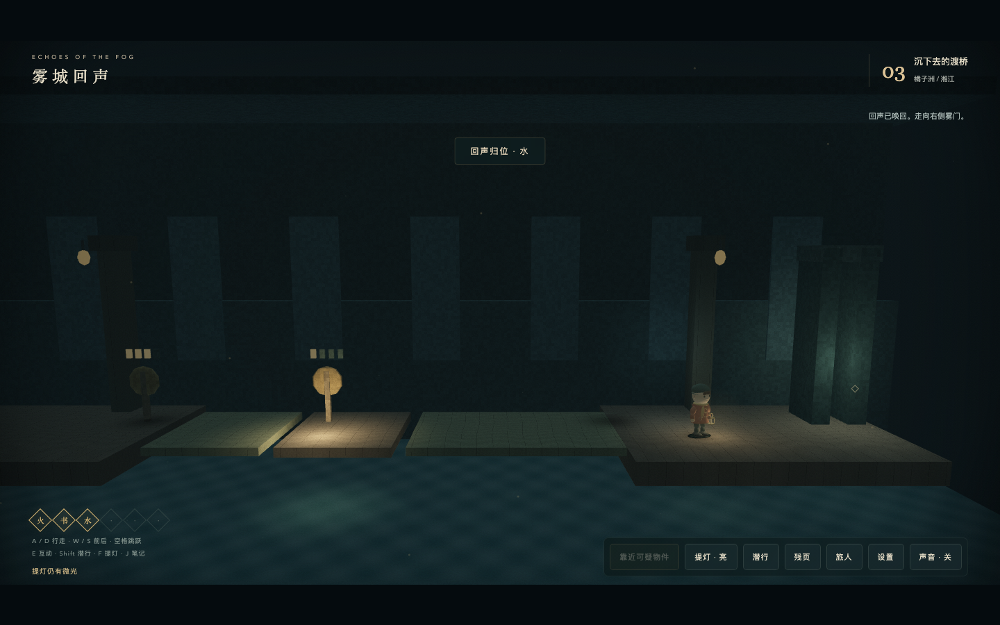
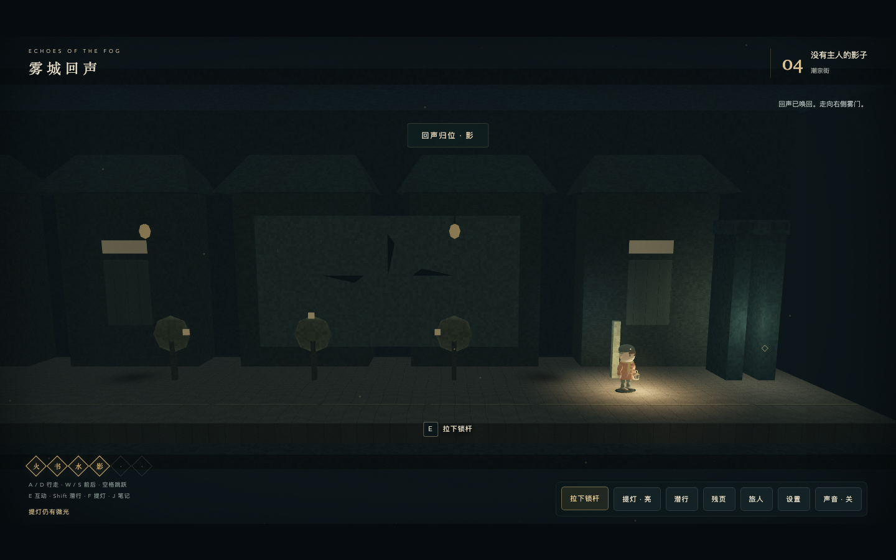
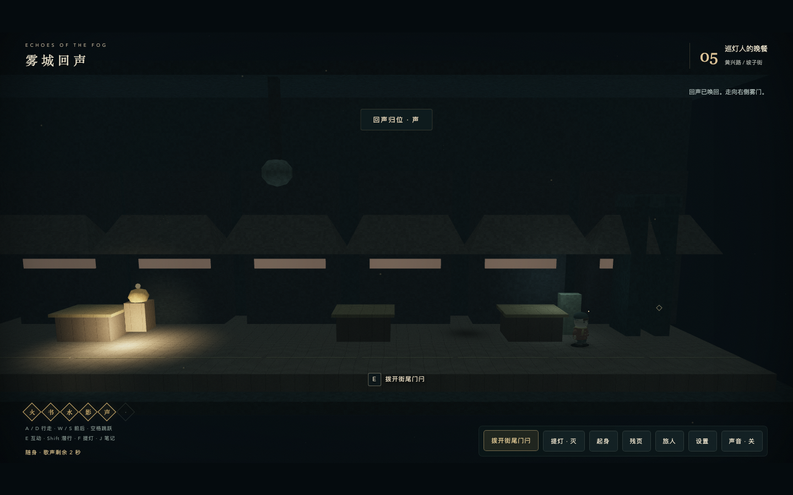
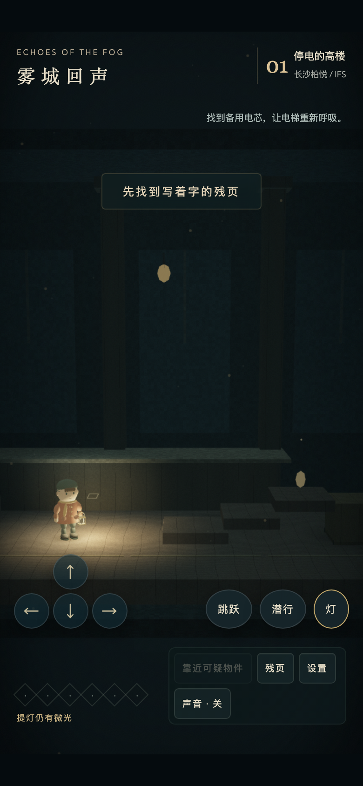
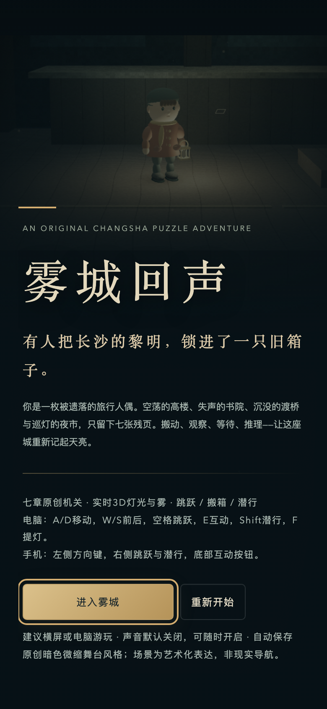

# 雾城回声 · 长沙周末 3D
### Echoes in the Fog · A Changsha 3D Mystery Adventure & Travel Odyssey

> **零外部依赖 · 纯原生 WebGL 1.0 · Web Audio API · 单文件即开即玩 · 桌面 / 移动端全适配**



---

## 目录
- [作品简介](#作品简介)
- [游戏矩阵](#游戏矩阵)
- [核心特性与亮点](#核心特性与亮点)
- [画廊与视觉展示](#画廊与视觉展示)
- [七章解谜机制（雾城回声）](#七章解谜机制雾城回声)
- [操作指引](#操作指引)
- [技术架构与设计哲学](#技术架构与设计哲学)
- [文件结构](#文件结构)
- [本地运行与测试](#本地运行与测试)
- [更新日志](#更新日志)

---

## 作品简介

本项目是一套以**中国长沙地标人文风貌**为灵感构建的轻量级 3D 网页游戏矩阵。在**零第三方引擎（无 Three.js / Babylon.js）、零模型文件下载、单文件离线极速运行**的纯原生 Web 技术约束下，通过数学程序化建模、光线物理着色与 Web Audio 音频合成，呈现极具独立艺术调性的微缩箱庭世界。

项目内包含两个独立定位的完整作品：
1. **《雾城回声》（主打核心）**：暗色微缩舞台（Diorama）风格的七章悬疑解谜冒险游戏。玩家扮演被遗落在失去黎明的雾城中的人偶“拾光人”，提灯穿行于高楼、书院、湘江沉桥、古街、夜市与博览馆，寻找回声碎片，唤醒破晓之门。
2. **《长沙漫游记》（随行导览）**：明亮卡通低多边形风格的 3D 旅行伴侣小游戏。包含 14 个景点场景与 3 条精选游览路线，集印章、听故事、双视角切换与行程接驳。

---

## 游戏矩阵

| 游戏作品 | 文件入口 | 风格类型 | 核心体验 |
| :--- | :--- | :--- | :--- |
| **雾城回声 (Echoes in the Fog)** | [`雾城回声.html`](雾城回声.html) | 暗色微缩箱庭 / 悬疑解谜 | 提灯潜行、物理拖箱、沉桥跳跃、机械巡灯、帛画拼图、跨章符号锁 |
| **长沙漫游记 (Changsha Odyssey)** | [`长沙漫游记.html`](长沙漫游记.html) | 明亮卡通 Low-Poly / 旅行导览 | 自由探索、印章收集、景点故事、第一/第三视角切换、接驳换乘 |

---

## 核心特性与亮点

### 1. 极致精细的手感与物理表现（Game Feel）
* **跳跃土狼时间（Coyote Time 140ms）**：离开平台边缘悬空 140ms 内按起跳依然有效，彻底消除边缘跌落的吃键挫败感；
* **落地跳跃缓冲（Jump Buffering 180ms）**：空中落地前 180ms 提前按跳跃，落地瞬间自适应无缝触发连续起跳；
* **挤压与拉伸弹性形变（Squash & Stretch）**：起跳瞬间人物垂直拉伸（+0.24），高速着陆时根据下落速度自适应下蹲吸震压缩（最大 -0.26）并平滑回弹；
* **重物搬运物理反馈**：双手贴合推拉货箱，自动校准面向锁定 Z 轴；搬运时提灯挂腰侧照地，箱底摩擦产生木屑灰尘颗粒与木质刮擦低频音；
* **360° 仿实体半透明触控摇杆**：手机端提供流畅无级模拟摇杆，支持死区判断、行走/快跑模拟速度线性映射，并完美向下兼容十字方位按钮。

### 2. 电影级微缩光影与原生着色（Visuals & Shaders）
* **ACES Filmic 胶片色调映射**：在 WebGL 片元着色器中采用影视级 ACES 拟合曲线，亮部高光拥有柔和的肩部滚降（杜绝死白过曝），阴影暗部保持扎实的黑阶与冷暖层次；
* **移轴微缩镜头模糊（Tilt-Shift Miniature Lens）**：画面上下边缘融合自适应径向羽化模糊层，模拟微距大光圈定焦镜头，显著强化“桌面玩具箱庭”的悬疑舞台氛围；
* **高精度程序化人偶模型**：主角“拾光人”拥有 1.04 万三角面与 58 个细分构件，细致刻画针织帽、围巾流苏、皮靴、挎包、双层风衣、缝线纽扣，皮肤、织物、皮革与黄铜采用分离材质着色。

### 3. 全原生程序化环境拟音（Procedural Audio Foley）
* **分材质环境脚步声**：通过低频正弦波与可变带通噪声发生器，实时区分书院木地板（260–380Hz 暖低频）、橘子洲浅滩碎石（620–920Hz 微溅水声）、石阶与潜行轻步；
* **黄铜提灯开关**：双振荡器模拟金属弹片卡扣清脆脆响与共振余鸣；
* **齿轮机械棘轮**：水闸与影轮转动具有机械咬合锯齿波声；
* **潜行危机双联心跳（Lub-Dub）**：巡灯人关卡中，心跳频率与振幅随警觉度（`alertLevel`）急促攀升，极大增强潜行压迫感；
* **现代浏览器手势音频自动激活**：无缝兼容 Safari 与移动端音频策略。

### 4. 世界内实体化互动与去锐角雕琢（Diegetic Interactions）
* **巡灯人实体化机械造型**：天际架设横跨全街的重型工字钢桁架天轨，悬挂式双轴滑车搭载下垂液压悬臂与巨型铆接黄铜独眼聚光头。独眼平时为冷冽青金，发现玩家时警报转为猩红脉冲；唱机发声时头部剧烈颤动偏向声源；
* **3D 旋转水闸与连续平滑沉桥**：水闸手轮随调节实时 90° 啮合旋转，立柱附带 4 级垂直铜刻标尺与指针；桥梁告别离散突变，具备液压阻尼连续升降动画与潮湿水线石雕暗斑；
* **书院青铜风铃与“风铃喑哑”**：每座灯台挂有实体青铜风铃，乱序时播放拍频共振的喑哑哀鸣，灯火渐隐，提供温和消解动画；
* **汉代帛画 3D 浮雕展板**：博物院墙面展现上（天界）、中（人间）、下（冥界）三层大漆壁龛，实时渲染“星”（八芒日轮）、“舟”（龙首行舟）、“山”（三神山）立体浮雕。

---

## 画廊与视觉展示

| 拾光人角色细节（1.04 万面） | 停电高楼 · 跳台与配电箱 |
| :---: | :---: |
|  |  |

| 岳麓书院 · 青铜风铃与灯火 | 橘子洲 · 沉桥与水闸 |
| :---: | :---: |
|  |  |

| 潮宗街 · 影子迷局 | 黄兴路 · 机械巡灯人潜行 |
| :---: | :---: |
|  |  |

| 移动端 360° 触控摇杆适配 | 移动端微缩舞台主界面 |
| :---: | :---: |
|  |  |

---

## 七章解谜机制（雾城回声）

| 章节 | 地标原型 | 核心机制与物理谜题 | 解谜线索与目标 |
| :--- | :--- | :--- | :--- |
| **01 停电的高楼** | 长沙 IFS / 柏悦酒店 | 跳跃攀台拾电芯、配电箱安装通电、抓住并左右拖拽重型货箱、黄铜重力踏板 | 供电与货箱重量必须同时满足，电梯门方可解锁 |
| **02 书院的无声铃** | 岳麓书院 | 辨析石碑线索推导「水、城、书、山」四灯顺序；实体青铜风铃与防挫败渐隐 | 乱序则风铃喑哑、灯火全灭重置 |
| **03 沉下去的渡桥** | 橘子洲 / 湘江 | 左右岸 3D 旋转水闸分别控制两段渡桥液压升降；未升桥处为断崖水瀑；升桥后跳过接缝 | 结合渡工残页刻度调整两岸水闸，搭桥过江 |
| **04 没有主人的影子** | 潮宗街 | 旋转三个影轮改变石墙上的投影形态，调整至东、天、西对应朝向，拉下拉杆开门 | 影轮仅改变几何朝向，必须拉动确认锁杆 |
| **05 巡灯人的晚餐** | 黄兴路 / 坡子街 | 拾取发条修复唱机，启动 14 秒歌声诱导巨型机械巡灯人转向；关灯并潜行越过街区门闩 | 巡灯人对提灯光芒与奔跑脚步极度敏感 |
| **06 帛画里的天亮** | 湖南博物院 | 探寻三个展柜收集「星、舟、山」碎片，根据汉代展签三层寓意在 3D 展柜进行图徽重组 | 天象在上、行舟居中、群山在下 |
| **07 把黎明带回去** | 返程之门 | 门楣雕刻 6 个神圣回声插槽，按前六章通关顺序依次填入火、书、水、影、声、星符号石盘 | 跨章节符号锁；全六章回声归位，破晓大门开启 |

---

## 操作指引

### 💻 电脑端（键盘与鼠标）
* **A / D** 或 **← / →**：左右移动
* **W / S** 或 **↑ / ↓**：前后景深微移
* **Space（空格键）**：跳跃（支持边缘土狼时间与空中预判落地缓冲）
* **Shift**：潜行（下蹲放轻脚步，巡灯区必用）
* **E**：互动（拾取物品、拖动货箱、操作机关水闸、调查残页）
* **F**：开关随身黄铜提灯
* **J / Esc**：打开旅行残页 / 关卡线索

### 📱 手机与触屏端
* **左侧 360° 发光摇杆**：任意方向滑移操控，阻尼支持行走/快跑模拟速度；
* **右侧跳跃按钮**：触发跳跃与拉伸弹性形变；
* **右侧潜行按钮**：一键切换直立/潜行屈身姿势；
* **提灯按钮**：一键点亮/收起提灯；
* **底部上下文操作钮**：靠近道具与机关时高亮提示 `[E] 交互`。

---

## 技术架构与设计哲学

1. **零外部依赖（Zero-Dependency Pure Native Stack）**：
   不依赖任何 NPM 运行时包、外部 CDN 脚本、字库或 3D 静态模型文件。仅需一个 `.html` 文件，离线双击即可在任何现代浏览器中渲染出完整的 3D 物理交互世界。
2. **离线单文件封装（Single-File Offline Architecture）**：
   HTML + CSS + 原生 ES6 JS + WebGL 1.0 Shader 统一内嵌，页面加载时间 < 100ms，内存占用极低。
3. **程序化数学网格生成（Procedural Geometry Engine）**：
   场景所有几何形体（包括万面人偶、欧式圆柱、飞檐屋顶、齿轮棘轮、机械巡灯）均通过球体、柱体、圆环体、挤出多边形等基础几何的顶点变换与法线平滑算法生成。
4. **状态隔离存档（Independent LocalStorage Persistence）**：
   游戏状态保存在 `localStorage['changsha-fog-puzzle-v1']`，显示与舒适度偏好保存在 `localStorage['changsha-fog-puzzle-v1-preferences']`，即使离线刷新也永不丢失进度。

---

## 文件结构

```text
长沙周末3D/
├── 雾城回声.html                     # 【主游戏】单文件全量版：原生 WebGL + Foley 音效 + 7章解谜
├── 雾城回声-README.md                # 《雾城回声》专属详细开发文档与各阶段技术规格
├── 雾城回声-v1.html                  # 原始解谜版本基线（保留作版本回退与对比参考）
├── 长沙漫游记.html                   # 【伴侣游戏】卡通旅行导览版：14个场景、3条漫游路线
├── README.md                         # 仓库总览文档（当前文件）
├── .gitignore                        # Git 忽略配置
├── renders/                          # 游戏各章节 4K/高清实机渲染截图
│   ├── 雾城回声/                     # 标题、角色建模、7章场景与移动端适配实拍
│   └── ...                           # 旧版漫游记实拍
├── qa/                               # 自动化质量保障与端到端测试脚本
│   ├── fog-browser-check.cjs         # 浏览器真实输入与按帧全流程自动化测试
│   └── fog-polish-check.cjs          # 质感优化与布局溢出检查
└── ...                               # 场景数据与元数据配置（itinerary.json 等）
```

---

## 本地运行与测试

### 运行方式
无需安装 Node.js、无需构建打包、无需启动 Web 服务器：
1. 双击直接在浏览器中打开 **[`雾城回声.html`](雾城回声.html)**；
2. 推荐使用 Google Chrome、Safari、Edge 等支持 WebGL 的现代浏览器；
3. 点击界面右上角“声音”按钮以启用环境音效与脚步拟音。

### 自动化测试（QA）
若本地装有 Node.js 环境，可复跑端到端浏览器自动化验证：
```bash
# 运行雾城回声完整七章物理与解谜自动化验收
node qa/fog-browser-check.cjs

# 运行质感优化、镜头视角与 320/390px 布局检查
node qa/fog-polish-check.cjs
```

---

## 更新日志

* **v5（2026-10-14 · 交互设计与机关具象化）**：
  - 黄兴路巡灯人具象化：增设悬挂工字钢天轨、滑行滑车、液压悬臂与警戒变色独眼聚光头；
  - 橘子洲水闸与沉桥具象化：3D 旋转手轮、垂直刻度标尺、平滑液压动力学与潮湿水线暗斑；
  - 岳麓书院风铃实体化与“风铃喑哑”拍频共振防挫败渐隐动画；
  - 湖南博物院汉代帛画三层 3D 浮雕展板（日轮、行舟、神山）；
  - 终章破晓石门 6 枚彩色元素符文插槽；配电箱软管电缆与货箱包角护铁。
* **v4（2026-10-14 · 视听沉浸与程序化音效 Foley）**：
  - 引入移轴摄影景深羽化模糊（Tilt-Shift）；
  - WebGL 着色器重构为工业级 ACES Filmic 电影色调映射；
  - 基于 Web Audio 研发程序化脚步拟音（区分书院木板、浅滩水花与室内石阶）、黄铜提灯开关、齿轮机械棘轮声与双联潜行心跳。
* **v3（2026-10-14 · 手感与物理弹性反馈）**：
  - 加入 140ms 跳跃土狼时间与 180ms 落地跳跃缓冲；
  - 加入身形挤压与拉伸弹性形变（Squash & Stretch）；
  - 升级 360° 实体级仿生触控虚拟摇杆与拖箱阻尼反馈。
* **v2（2026-10-13 · 角色质感与主菜单升级）**：
  - 主角迭代为 1.04 万面原创“拾光人”，具备平滑法线与织物/皮革着色；
  - 新增实时 3D 舞台主菜单、人物观察镜与多档场景亮度调节。
* **v1（2026-10-13 · 诞生）**：
  - 《雾城回声》七章独立解谜冒险立项诞生，提供原生 WebGL 箱庭冒险体验。

---

*Made with passion for Changsha & Indie WebGL Gaming.*
